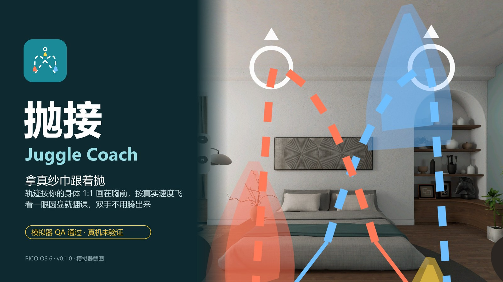
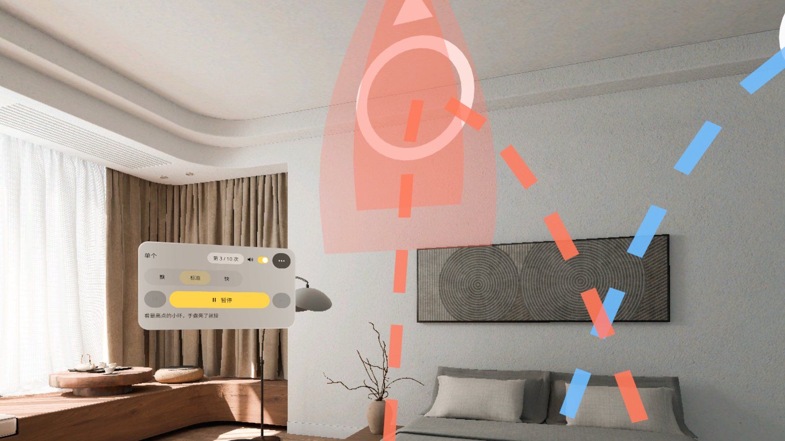
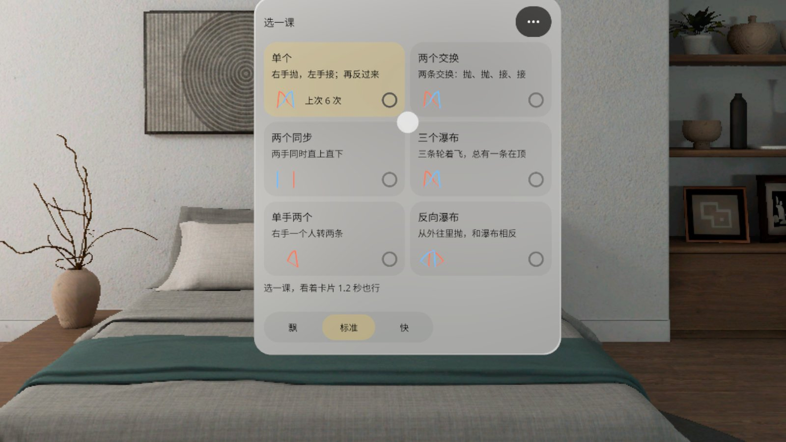
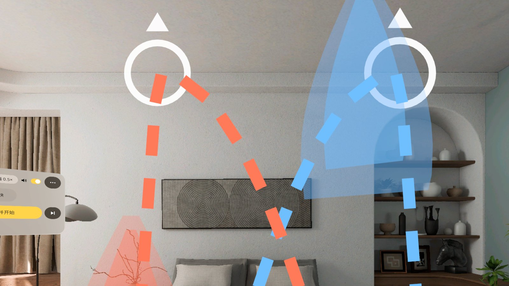
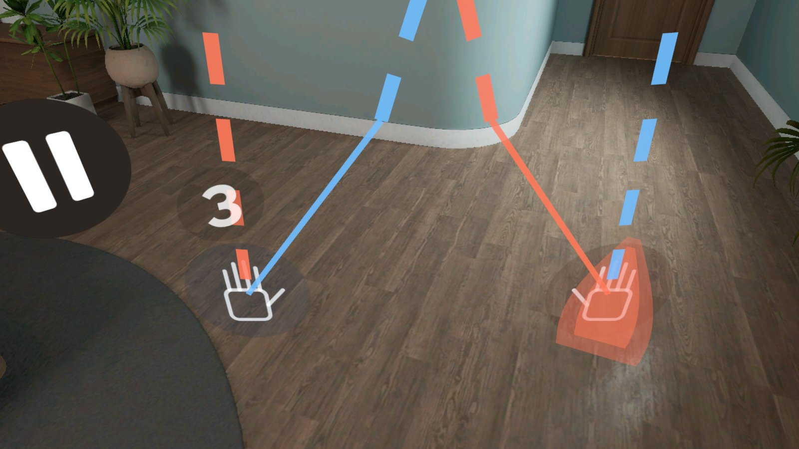
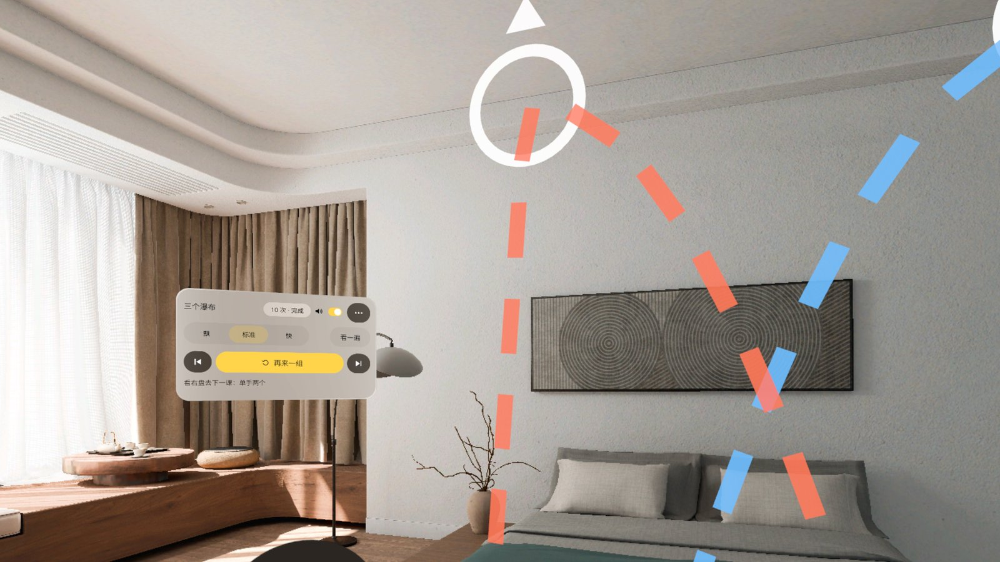
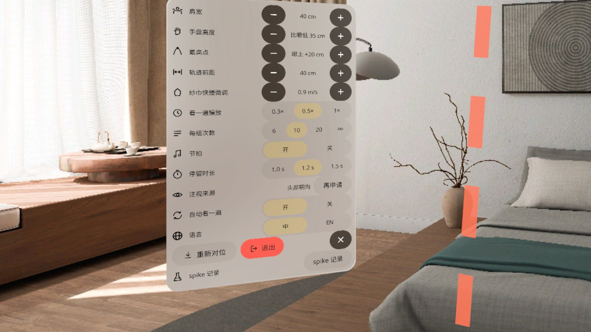

# 抛接 Juggle Coach

> **v0.1.0 · 预发布 · 模拟器 QA 通过，真机未验证**（Pre-release · passed emulator QA, not yet verified on a headset）



[中文](#中文) · [English](#english)

---

## 中文

拿真纱巾跟着抛。PICO OS 6 混合现实应用：抛接轨迹按你的肩宽和眼高 1:1 画在胸前，幽灵纱巾按真实纱巾的速度飞，配节拍声告诉你什么时候抛；暂停、再来、下一课都是**看一眼左右两个圆盘**就触发，双手一直拿着纱巾。

- **六课**：单个 → 两个交换 → 两个同步 → 三个瀑布 → 单手两个 → 反向瀑布
- **看一遍 → 预备拍 → 跟做**：先慢放三遍看轨迹，再「4 3 2 1」进拍子，跟着计数（第 n / 10 次）
- **对位**：开始前看着准星 1 秒，轨迹按你当前的位置和朝向摆好；走开或转身会自动暂停并半透明，站定 1 秒滑回面前
- **身体参数可调**：肩宽、手盘高度、最高点、轨迹间距、纱巾快慢、每组次数、节拍开关、停留时长、注视来源（眼动 / 头部朝向）
- 眼动不可用时自动改用头部朝向并提示一次；可静音（记住设置）；中英双语；不联网、不需要账号

### 截图（模拟器，中文界面）

| | |
|---|---|
|  跟做：纱巾按真实速度飞，左侧控制面板计数 |  选课：六课 + 纱巾快慢 |
|  看一遍：课 4 三条纱巾慢放 |  预备拍：手盘上方 4 3 2 1 |
|  一组完成：看右盘下一课、左盘再来一组 |  更多：身体参数和偏好 |

截图都来自 PICO 模拟器（High Definition 2560），状态用调试广播定住拍摄。演示视频（Release 附件 `JuggleCoach-demo-1080p.mp4`）是模拟器上由调试输入驱动的演示，**非真实手势录像**，无声。

### 安装

```bash
adb install -r JuggleCoach-v0.1.0.apk
pico-cli app launch io.embodit.jugglecoach
```

APK 在 [Release v0.1.0](https://github.com/kejing-dev/JuggleCoach/releases/tag/v0.1.0)。需要 PICO OS 6（Spatial SDK 6.1.9，minSdk 35）。第一次启动会申请眼动权限，拒绝也能用（改用头部朝向）。

### 真机未验证

模拟器上过了三道门禁（无 Material 组件、启动 60 秒无崩溃 / ANR、17 个状态全部截图核对）。下面这些只有戴上头显才能确认：

- 眼动注视停留的命中率、眼动权限「允许」路径
- 两手拿纱巾时捏合会不会误判；真纱巾和轨迹对不对得上、最高点在不在视场内、节拍跟不跟得上（菜单第 ⑭ 行有 spike 检查单）
- 节拍声和画面是否同步、默认音量是否克制
- 透视画面下玻璃面板的对比度

### 已知问题（不挡用）

1. 准备中的转圈画在控制面板右缘，不在正中（只出现约 0.5 秒）。
2. 控制面板在 0.9 米外左侧 42°，提示行字偏小，真机上要看是否吃力。
3. 对位第一步的准星会挡住选课面板上部约 1 秒（设计如此）。
4. 开关（Switch）的关状态在浅色玻璃上偏淡。
5. 右手纱巾停在手盘上时盖住手形图标。
6. 偏离后的半透明状态在模拟器上只停约 1 秒（真机人会晃，停留更长）。

### 开发

Kotlin · PICO Spatial SDK 6.1.9 · 一个 Mixed Stage。结构、调试广播、截图脚本见 [AGENTS.md](AGENTS.md)。字体 Noto Sans / Noto Sans SC（SIL OFL 1.1，见 `third_party/`）；节拍声在应用内合成。

---

## English

Juggle real scarves along with a guide. A PICO OS 6 mixed-reality app: the throw paths are drawn life-size in front of your chest, scaled to your shoulder width and eye height; ghost scarves fly at real scarf speed with a beat that tells you when to throw. Pause, repeat and next lesson are triggered by **looking at one of two discs**, so your hands stay on the scarves.

- **Six lessons**: one scarf → two-scarf exchange → two in sync → three-scarf cascade → two in one hand → reverse cascade
- **Watch → count-in → follow**: watch the path three times in slow motion, count in "4 3 2 1", then follow along with a counter (n / 10)
- **Align**: look at the reticle for 1 s and the paths are placed for where you stand and face; walk off or turn and it pauses and fades, stand still for 1 s and it slides back
- **Adjustable**: shoulder width, hand-disc height, peak height, path spacing, scarf speed, reps per set, beat on/off, dwell time, gaze source (eyes / head)
- Falls back to head direction when eye tracking is unavailable; mute (remembered); Chinese and English; offline, no account

### Screenshots

See the table above (Chinese UI on the PICO emulator, High Definition 2560, states pinned with debug broadcasts). The demo video in the release (`JuggleCoach-demo-1080p.mp4`) is driven by debug input on the emulator — **not a recording of real hand gestures** — and has no sound.

### Install

```bash
adb install -r JuggleCoach-v0.1.0.apk
pico-cli app launch io.embodit.jugglecoach
```

Get the APK from [Release v0.1.0](https://github.com/kejing-dev/JuggleCoach/releases/tag/v0.1.0). Requires PICO OS 6 (Spatial SDK 6.1.9, minSdk 35). The app asks for eye tracking on first launch; it still works if you decline (head direction instead).

### Not yet verified on a headset

It passed three emulator gates (no Material components, 60 s launch with no crash / ANR, all 17 states captured and checked). Only a headset can confirm: eye-gaze dwell hit rate and the permission "Allow" path; pinch false positives while holding scarves; whether real scarves match the paths, the peak stays in view and the beat is followable (spike checklist in menu row 14); audio/visual sync and default volume; glass panel contrast over passthrough.

### Known issues (non-blocking)

1. The loading spinner sits on the right edge of the control panel, not centred (~0.5 s).
2. The control panel is 0.9 m away at 42° left; its hint line may be small on a headset.
3. During alignment the reticle covers the top of the lesson picker for ~1 s (by design).
4. Switch "off" state is faint on light glass.
5. The right-hand scarf covers the hand icon on its disc.
6. The faded "drifted" state only lasts ~1 s on the emulator.

### Development

Kotlin · PICO Spatial SDK 6.1.9 · one Mixed Stage. See [AGENTS.md](AGENTS.md) for structure, debug broadcasts and screenshot scripts. Fonts: Noto Sans / Noto Sans SC (SIL OFL 1.1, `third_party/`). Beat sounds are synthesised in the app.
